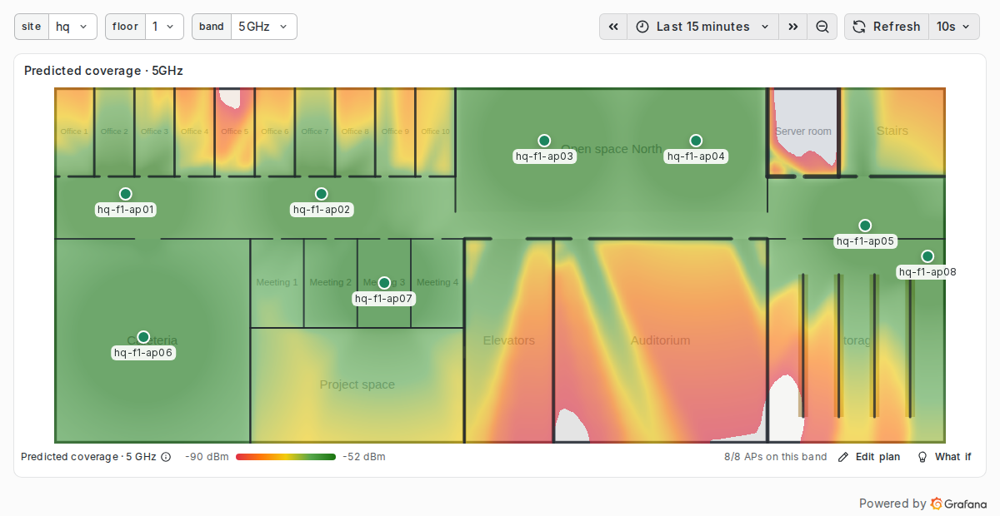

# Wi-Fi coverage panel for Grafana

Grafana panel plugin `kentrow-wificoverage-panel` that draws the predicted Wi-Fi coverage of each access point on a floor plan, band by band, with wall losses and coverage holes.



User documentation (data contract, plan editing, what-if mode, options, radio model): [src/README.md](src/README.md). It is also the page shown in the Grafana plugin catalog.

The project was scaffolded with `@grafana/create-plugin`. Do not edit `.config/`; extend its configurations from the files at the root.

## Development environment

Requirements: Node 22 with npm, and Docker.

```shell
npm install
npm run dev              # watch build into dist/
docker compose up -d     # Grafana, Prometheus and a simulated exporter
```

| Service            | URL                   | Purpose                                                                                |
| ------------------ | --------------------- | -------------------------------------------------------------------------------------- |
| Grafana OSS 13.2.3 | http://localhost:3000 | Dashboards "Wi-Fi coverage (dev)", "Wi-Fi AP detail" and "Wi-Fi coverage (e2e)"        |
| Simulated exporter | http://localhost:9105 | `aruba_*` metrics of the data contract; its home page takes an access point down or up |
| Prometheus         | http://localhost:9090 | Scrapes the exporter every 5 s                                                         |

To use other ports, set `GRAFANA_PORT`, `PROMETHEUS_PORT` or `EXPORTER_PORT`, for instance in a `.env` file next to `docker-compose.yaml` (ignored by git).

[dev/sites.py](dev/sites.py) describes the simulated sites in metres: a two-floor head office (brick offices, a concrete auditorium without access point, a metal server room, an under-equipped second floor) and a 140 × 60 m warehouse whose racks block the signal, so the plans show every coverage level. `python3 dev/generate.py` derives from it the SVG plans (`dev/floorplans/`, served under `public/floorplans/`), `dev/site.json` read by the exporter, the dev dashboard with the wall geometry and the e2e dashboard. After a change to `plugin.json`, the sites or the provisioned dashboards, run `docker compose up -d --force-recreate`.

## Tests

```shell
npm run typecheck && npm run lint && npm run test:ci
npm run e2e              # Grafana must be running; set GRAFANA_URL if it is not on localhost:3000
```

The Jest tests cover the radio model (computation time included), the join of the data frames, plan editing and the what-if mode. The model tests run in Jest's `node` environment with the same ES2015 target as the build, so that the measured times are meaningful. The end-to-end tests use `@grafana/plugin-e2e` with TestData frames shaped like Prometheus ones, so they do not depend on the exporter.

## Packaging and release

```shell
npm run package          # production build, then artifacts/kentrow-wificoverage-panel-<version>.zip
npx -y @grafana/plugin-validator@latest artifacts/kentrow-wificoverage-panel-<version>.zip
```

The archive holds a folder named after the plugin ID, to unzip into the Grafana plugins directory. Until the plugin is signed, allow it with `GF_PLUGINS_ALLOW_LOADING_UNSIGNED_PLUGINS=kentrow-wificoverage-panel`.

Pushing a `v*` tag runs the release workflow: it builds the plugin, attests its provenance and attaches the archive to a GitHub release.

## Layout

```text
src/
  module.ts                    panel registration and options
  migrations.ts                upgrade of options saved by older versions
  types.ts                     access points, walls, materials, options
  data/frames.ts               join of the frames by access point, last value of each series
  model/geometry.ts            segment intersection
  model/propagation.ts         log-distance model, band and material defaults
  model/grid.ts                grid of the best and second-best signal, signal at a point
  model/scene.ts               options and access points to a scene in metres, geometry validation
  model/layout.ts              plan editing: positions, walls, rooms, scale, what-if
  worker/                      grid computation off the main thread, with a main-thread fallback
  render/                      colour scales, grid to image
  components/                  panel, map, editors, markers, tooltip, legend
tests/                         end-to-end tests
dev/                           simulated sites, exporter, plan and dashboard generator
provisioning/                  data sources and dashboards of the development Grafana
```

## License

[Apache License 2.0](LICENSE)
